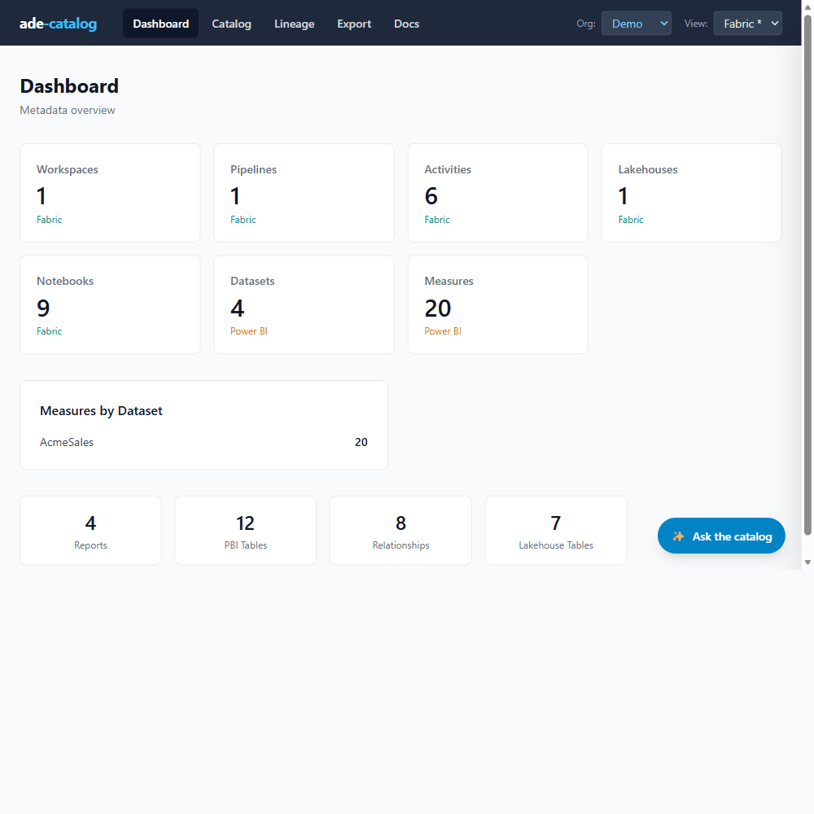

# ade-catalog — ADE (Agentic Data Engineering)

**A local, self-hostable metadata catalog for Databricks + Power BI** — with
cross-platform lineage, an interactive graph explorer, and an MCP server so Claude
can query your data estate.



> **Preview edition.** This is the open, self-host preview: SQLite, local, no login,
> Power BI + Databricks from files you already have.

## What it does

- **Parse** Power BI (TMDL / PBIP projects) and Databricks (`.py` notebooks) from files on disk
- **Catalog** every table, measure, notebook, report across platforms — browse + full-text search
- **Trace** cross-platform lineage in an interactive graph (bronze → gold → semantic model → measure)
- **Ask** — an MCP server exposes the catalog to Claude Desktop / Claude Code

## Quick start

```bash
git clone https://github.com/rbutinar/ade-catalog.git
cd ade-catalog
pip install -r requirements.txt          # SQLite = stdlib; no DB drivers to install

# 1. Create the local SQLite catalog
python -m ade_catalog.schemas.deploy_sqlite

# 2. Build the demo catalog (synthetic Acme estate)
python -m ade_catalog.ingest --source demo
python -m ade_catalog.cli lineage build --view Demo

# 3. Browse it
python -m ade_catalog.cli serve            # http://localhost:5001
```

Everything runs locally against a SQLite file — no accounts, no cloud, no login.

## Use it with Claude (MCP)

The bundled `.mcp.json` starts the catalog's MCP server over stdio — just open the
project in Claude Code, or add it to Claude Desktop:

```json
{
  "mcpServers": {
    "ade-catalog": {
      "command": "python",
      "args": ["-m", "ade_catalog.mcp_server.stdio"],
      "cwd": "/path/to/ade-catalog"
    }
  }
}
```

Then ask: *"What measures depend on the sales fact table?"*, *"Trace the lineage from
bronze to the Power BI model"*, *"Which notebooks write to gold?"*

## Bring your own data

Drop your exported files under `ade_data/<env>/inputs/` and rebuild:

- **Power BI** — a PBIP project's `definition/` folder (TMDL): tables, columns, measures (DAX), relationships
- **Databricks** — exported `.py` notebooks: table lineage (inputs/outputs) with variable resolution

```bash
python -m ade_catalog.ingest --source ade_data/my_env/inputs --view "My Env"
python -m ade_catalog.cli lineage build --view "My Env"
```

## This repository vs. the hosted app

| | This repository (public core) | Hosted app (sign-in) |
|---|---|---|
| Backend | SQLite, local | Postgres / SQL Server, multi-tenant |
| Sources | Power BI + Databricks, from files | + Fabric, Qlik, Tableau, SAP BusinessObjects and BW, Oracle, SSIS, Informatica, Talend, Synapse, PostgreSQL, dbt, Cloudera, … + live extraction |
| Lineage graph | ✅ interactive explorer | ✅ + large-graph performance |
| MCP | ✅ (stdio + HTTP) | ✅ hosted, org-scoped |
| AI assistant, AI enrichment, Excel/query export, data products | — | ✅ |
| Publish & share (multi-user, RLS) | — | ✅ |

Not everything is public. Some parts stay private for reasons of security and confidentiality,
some were developed under specific commercial agreements, and some are not released yet. The
public core is what you build on: the data model, the connector pattern and the MCP interface.
Add a connector, adapt it to your estate, contribute back.

A hosted demo runs at [ade-catalog.vercel.app](https://ade-catalog.vercel.app): sign up; with an
invitation code you get the demo at once, otherwise you join the waiting list.
More about the family: [ade-family.com](https://ade-family.com).
Contact: [hello@ade-family.com](mailto:hello@ade-family.com).

## License

Apache 2.0 — see [LICENSE](LICENSE).

**Roberto Butinar** — [LinkedIn](https://linkedin.com/in/rbutinar) · [GitHub](https://github.com/rbutinar)
